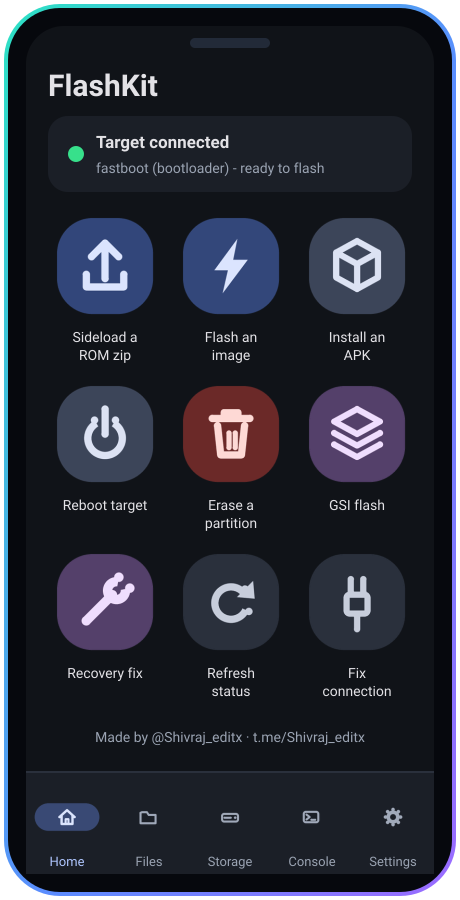
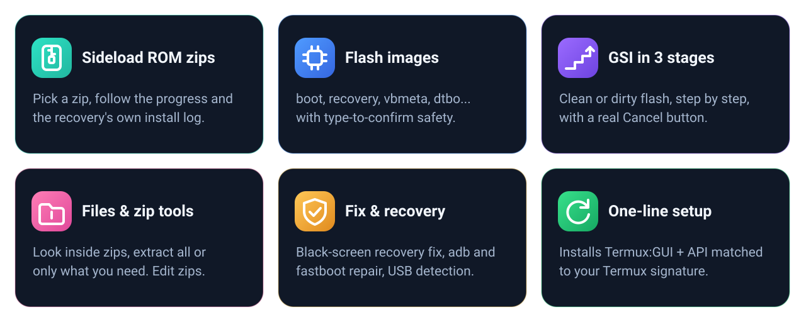
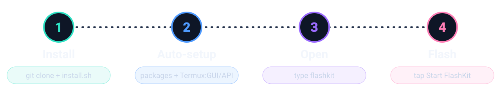

<div align="center">



[](https://github.com/shivrajtode/flashkit/tags)
[](https://github.com/shivrajtode/flashkit/stargazers)
[](https://github.com/shivrajtode/flashkit/actions)
[](LICENSE)

[](https://github.com/termux/termux-app#installation)
[](#-before-you-start)
[](https://t.me/Shivraj_editx)

**Flash, sideload and rescue a second Android device - straight from your rooted phone.**<br>
No PC. No cables to a computer. Just an OTG cable and Termux.

[**📲 Install**](#-install-in-3-steps) &nbsp;·&nbsp; [**🚀 Use it**](#-open-flashkit) &nbsp;·&nbsp; [**🧭 Features**](#-what-can-it-do) &nbsp;·&nbsp; [**🔄 Update**](#-update) &nbsp;·&nbsp; [**🆘 Help**](#-help--troubleshooting)

</div>

<br>

## ✨ What is FlashKit?

FlashKit turns your rooted phone into a **pocket flashing station**. Plug a second device into it with an OTG cable and
use big, friendly buttons (a real Android app screen, not a wall of text) to sideload ROMs, flash images, do GSI
installs, fix a black-screen recovery, and more. It even has a built-in **file manager with zip tools**.

<table>
<tr>
<td width="62%" valign="top">

- 🧩 **Installs itself** - one command sets up everything, including the Termux:GUI and Termux:API apps.
- 🔐 **Signature-aware** - picks the plugin builds that match *your* Termux, so they actually work together.
- 🛡️ **Careful by design** - confirmations, type-to-confirm for risky partitions, a real **Cancel** button.
- 📜 **Live logs** - see what adb/fastboot (and your recovery) are doing, copy them with one tap.
- 🔄 **One-command updates** - `flashkit update`.

<sub>Home screen shown as an illustration built from the app's real icons.</sub>

</td>
<td width="38%" align="center">

</td>
</tr>
</table>



<br>

## ✅ Before you start

| You need | Why |
|---|---|
| 📱 **A rooted Android phone** (Magisk or KernelSU) | Root is used only for the adb / fastboot calls |
| 🖥️ **Termux** from **[F-Droid](https://f-droid.org/packages/com.termux/)** or **[GitHub](https://github.com/termux/termux-app/releases)** | *Not* the Google Play version - it is outdated and can't run the plugins |
| 🔌 **An OTG cable / adapter** | To connect the device you want to flash |
| 🌐 **Internet** (first install only) | To download packages and the two plugin apps |

> [!TIP]
> Install Termux and its plugins from the **same place** (all F-Droid *or* all GitHub). FlashKit's installer checks this for you.

<br>

## 📲 Install in 3 steps



### Step 1 &nbsp;·&nbsp; Open Termux and paste this one line

```sh
pkg install -y git && git clone https://github.com/shivrajtode/flashkit && bash flashkit/install.sh
```

### Step 2 &nbsp;·&nbsp; Say **Yes** to the pop-ups

The installer does the rest. Android may ask you a few things - this is what to tap:

| You see | Tap |
|---|---|
| *"Allow Termux to access photos, media and files?"* | **Allow** |
| *Superuser request* (Magisk / KernelSU) | **Grant** (tick *remember*) |
| *Package installer* "Do you want to install this app?" (only if you have **no root**) | **Install** - if it says "not allowed", tap **Settings** → turn on **Allow from this source** → go back → **Install** |

> [!NOTE]
> Installing a plugin can make Android **restart Termux** once. That's normal - just open Termux again and the FlashKit menu opens by itself.

### Step 3 &nbsp;·&nbsp; Choose **Start FlashKit**

When the installer finishes, the FlashKit menu opens. Press **Start FlashKit** - the app window appears. 🎉

<details>
<summary><b>What does the installer actually do?</b> (click to see)</summary>

<br>

1. Installs `python`, `android-tools` (adb + fastboot), `git`, `curl`, `termux-api`, `dialog`.
2. Installs the `termuxgui` Python library.
3. Asks for storage access (so it can see your ROM zips).
4. Creates the commands **`flashkit`** and **`start flashkit`** (plus a *FlashKit* entry for the Termux:Widget home-screen widget).
5. Reads your **Termux signing key**, then downloads **Termux:GUI** and **Termux:API** from GitHub / F-Droid - only a build signed with the *same* key is accepted - and installs them (silently with root, or via Android's installer).
6. Opens FlashKit.

Plugins you already have installed and working are never touched. Run `flashkit setup` any time to repeat it safely.

</details>

<br>

## 🚀 Open FlashKit

Type this in Termux:

```sh
flashkit
```

| Menu entry | What it does |
|---|---|
| ▶️ **Start FlashKit** | Opens the app |
| 🔧 **Run manually (text menu)** | The older keyboard-driven version, for when you prefer text |
| ⬇️ **Update FlashKit** | Gets the latest version from GitHub |
| 🧩 **Check / install Termux:GUI + Termux:API** | Re-checks the two plugin apps |
| 🩺 **Doctor** | Checks root, adb/fastboot, plugins, storage permission |
| 🔁 **Open FlashKit when Termux starts** | Turn on to skip typing the command |

Shortcuts: `start flashkit` or `flashkit start` open the app straight away.

<br>

## 🧭 What can it do?

### 🏠 Home - the big buttons

| Button | What it does |
|---|---|
| **Sideload a ROM zip** | Pick a zip → FlashKit checks the device is ready → sideloads it, shows progress and the recovery's install log (live when your recovery allows it) |
| **Flash an image** | Choose a partition (boot, recovery, vbmeta, dtbo...) → pick the `.img` → confirm. Risky partitions need you to type the name |
| **Install an APK** | Install an app on the connected device (adb) |
| **Reboot target** | Reboot to system, recovery, bootloader or fastbootd |
| **Erase a partition** | Three gates (two warnings, then type the exact name) before anything is erased |
| **GSI flash** | Clean or dirty GSI install done in **3 safe stages** (vbmeta → fastbootd → system/super) |
| **Recovery fix** | Fixes the black screen in some recoveries (mounts the vendor partition) |
| **Refresh status / Fix connection** | Re-detect the device, or repair adb/fastboot if they crash |

### 📂 Files · 🗜️ Storage · 💻 Console · ⚙️ Settings

- **Files** - browse the *target* device's storage; push, pull, move and delete.
- **Storage** - your *own phone's* files, with **zip tools**:
  look **inside** a zip/tar without extracting · **extract all** or **only what you pick** · view a file inside · add, delete, rename and move things **inside** a zip · copy, move, rename, delete, compress.
- **Console** - ready-made adb / fastboot commands, or type your own.
- **Settings** - auto-fix, keep-screen-on, live install log, device auto-check, diagnostics, and **Quit completely** (force-stops everything).

📖 Step-by-step walkthroughs: **[docs/GUIDE.md](docs/GUIDE.md)** &nbsp;·&nbsp; 📝 What changed: **[CHANGELOG.md](CHANGELOG.md)**

<br>

## 🔄 Update

```sh
flashkit update
```

Gets the newest version from GitHub, shows what's new, and refreshes anything needed. Your settings are kept.

<br>

## 🧰 Command cheat-sheet

| Command | Does |
|---|---|
| `flashkit` | Open the menu |
| `flashkit start` · `start flashkit` | Open the app right away |
| `flashkit manual` | Text-menu version |
| `flashkit update` | Update |
| `flashkit plugins` | Check / install Termux:GUI + Termux:API |
| `flashkit doctor` (or `check`) | Health check |
| `flashkit autostart on` / `off` | Open the menu when Termux starts |
| `flashkit setup` | Re-run the installer |
| `flashkit uninstall` (`-y` for everything, no questions) | Remove FlashKit - asks what to delete (settings, the app files, Termux:GUI/API), or does all of it with `-y` |

<br>

## 🆘 Help & troubleshooting

<details>
<summary><b>"Signature" or "plugin" message / Termux:GUI won't install</b></summary>

<br>

Termux and its plugins only work together if they're signed by the same key. FlashKit reads your Termux's key and picks the matching download automatically. If it says nothing matches, reinstall **Termux, Termux:GUI and Termux:API all from F-Droid** (or all from GitHub), then run `flashkit plugins`.
</details>

<details>
<summary><b>Termux closed while installing</b></summary>

<br>
Normal - Android restarts Termux when a plugin is installed. Open Termux again; the FlashKit menu opens on its own (or type <code>flashkit</code>).
</details>

<details>
<summary><b>"Root denied" / the app can't flash</b></summary>

<br>
Open your root manager (Magisk / KernelSU) and allow **Termux**. Then run <code>flashkit doctor</code> - it should say <i>root works</i>.
</details>

<details>
<summary><b>The target device isn't detected</b></summary>

<br>

- Use a good OTG cable and plug it into the **target** end correctly; try another cable.
- Put the target in the right mode (adb on, **or** bootloader / fastbootd, **or** recovery with sideload).
- Tap **Refresh status** on Home. If the card says adb/fastboot are broken, tap **Fix connection now**.
- MediaTek **BROM** and Qualcomm **EDL** modes are *recognised* and explained, but need other tools (SP Flash Tool, mtkclient, EDL tools).
</details>

<details>
<summary><b>The app window doesn't open</b></summary>

<br>
Run <code>flashkit doctor</code>. Make sure Termux:GUI is installed, then try <code>flashkit plugins</code>. Look at <code>~/flashkit_gui.log</code> for details. If a window still won't appear, allow <b>Display over other apps</b> for Termux and Termux:GUI in Android settings.
</details>

<details>
<summary><b>A job seems stuck</b></summary>

<br>
Tap <b>Cancel job</b> on the job screen - it stops the whole process tree. Then <b>Copy</b> the output if you want to share it.
</details>

<details>
<summary><b>How do I uninstall FlashKit completely?</b></summary>

<br>

```sh
flashkit uninstall -y
```

That removes the `flashkit` / `start flashkit` commands, the Termux:Widget shortcut, the auto-start hook, FlashKit's settings and logs, the app files themselves, and uninstalls Termux:GUI and Termux:API. Run `flashkit uninstall` with no flag to be asked about each of those instead (handy if you want to keep the plugin apps for something else).
</details>

<details>
<summary><b>Where are the logs?</b></summary>

<br>
<code>~/flashkit_gui.log</code> (app) and <code>~/.flashkit/</code> (installer). Open an <a href="https://github.com/shivrajtode/flashkit/issues/new/choose">issue</a> and paste <code>flashkit doctor</code>.
</details>

<br>

## 🔒 Safety

> [!WARNING]
> Flashing can **erase data or make a device unbootable**. Use files made for your exact device, charge both devices, back up what matters, and read each confirmation before you tap. FlashKit is provided as-is, **at your own risk**.

<br>

<div align="center">

<a href="https://t.me/Shivraj_editx"></a>&nbsp;<a href="https://t.me/Shivraj_editx"></a>

If FlashKit saved you a trip to a PC, drop a ⭐ on the repo - it really helps!

<sub>MIT licensed · see <a href="LICENSE">LICENSE</a></sub>

</div>
